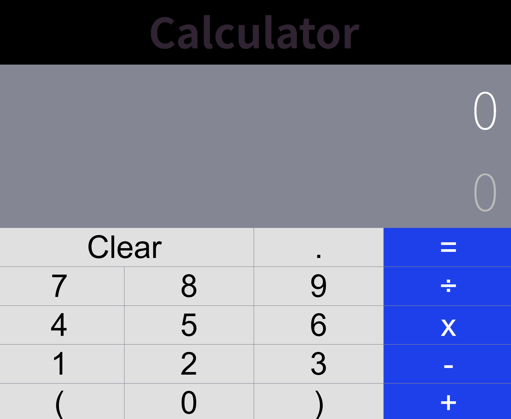

Calculator
# 1 Project Information
리액트를 활용해서 만든 계산기. 리액트에서 핵심인 상태와 컴포넌트를 공부하기 적합할 것 같아서 선택했다. 
### [원본 github url](https://github.com/sortizm/calculator)
 라이선스: MIT license

# 2 Installation
npm install로 설치, npm start로 실행
## 실행 화면

# 3 Source Code Exploration
## 1 Project Structure
주요 파일 2-3개의 역할

index.js가 코드의 시작점.
가상 컴포넌트를 웹 브라우저의 html 문서에 연결해줌.
- ReactDOM.render(...); 코드를 통해서 뼈대만 있는 순수 html 파일 내부의 
 태그 안에 끼워넣음

App.js가 전체 흐름 통제.
화면을 조립하고 계산 데이터 중앙 관리.
- state를 통해서 현재 계산기에 입력된 숫자, 연산 상태 기억
- handleClick 함수를 통해 사용자가 버튼을 누를 때 calculate 함수를 실행하여 결과를 상태로 업데이트
- render 안에 <Display/>와 <ButtonPanel/> 통해 하나의 계산기로 화면 조립

## 2 React Component
주요 컴포넌트 1-2개의 역할

Display 컴포넌트는 계산기 화면창을 보여줌
- 스스로 계산하거나 상태를 가지지 않는다. total과 operations 속성을 받아 화면에 렌더링함

ButtonPanel 컴포넌트는 키패드 컨테이너
- 여러 Button 컴포넌트들 줄을 맞춰 5개의 행으로 묶어 배치하는 역할
- 부모 App.js와 자식 Button.js 사이를 이어줌

## 3 Code Analysis
코드 1개(5-15줄) 선택하여 동작 원리 설명

calculate.js 내부 분석
분석할 코드
export default function calculate(obj, buttonName) {
  if (buttonName === "AC") {
    return RESET_OBJ;
  } else if (buttonName === "=") {
    return operate(obj.operations);
  } else {
    return { operations: (obj.operations || "") + buttonName }
  }
}

- 이 코드는 사용자가 계산기의 어떤 버튼을 눌렀느냐(buttonName)에 따라서 앱 상태 obj가 어떻게 변할지 결정하는 역할
- 사용자가 초기화 버튼 AC를 누르면 빈 상태(RESET_OBJ) 반환하여 화면을 지움
- = 버튼을 누르면 지금까지 입력된 obj.operations를 operate 함수로 넘겨 계산 수행
- 그 외 숫자나 기호 누르면 기존 수식 뒤에 글자를 그대로 이어 붙여 새로운 상태로 반환

# 4 Customizing
## 1 Text 수정
- **수정 파일:** `src/components/ButtonPanel.js`, `src/logic/calculate.js`
- **변경 전/후:** 초기화 버튼 이름이 AC에서 Clear로 변경

## 2 Style 수정
- **수정 파일:** `src/components/Button.css`
- **변경 전/후:** `.component-button.orange` 클래스의 배경색을 주황에서 파랑으로 변경

## 3 UI/Data 수정
- **수정 파일:** `src/components/App.js`
- **변경 전/후:** `<h1 style={{~}}>Calculator</h1> 추가

# 5 Deployment
[Vercel URL](calculator-awynr2fqd-oss22200250.vercel.app)

# 6 Weekly Review
## 새롭게 배운 내용
- React는 화면을 작은 컴포넌트들로 쪼개서 관리!
- Node.js 구버전으로 한 파일을 가져와서 쓰느라, fnm을 통해서 버전 스위칭하는 것을 배움 (fnm use 16)
- fork, clone, vercel 배포와 github 다중 remote 연동 등 기존 과제들에도 사용했던 개념들이지만 이번 과제를 수행하며 보다 깊이 이해할 수 있었음

## 어려웠던 점과 해결 방법

- Node.js 충돌: npm start를 해도 실행 안 되고 오류가 계속 떴는데, 버전 문제임을 알게 됨.
- 로컬에서는 node 버전을 16으로 다운그레이드해서 맞춰줌. vercel 배포할 때는 환경 변수 설정을 추가해주어 해결.

## AI 활용 및 느낀 점

- Text, Style, UI/Data 수정할 때 어떤 것을 수정하면 좋을지 추천받음
- npm start 명령이 먹히지 않아 오류가 떴을 때 해결하는 과정(Node.js 버전 충돌 방지)에 도움 받음

### 느낀 점
리액트라는 개념을 말로 배울 때는 와닿지 않았는데, 직접 실습을 해보면서 더 깊이 깨닫게 되었다. 과제 수행 중에 유난히 오류가 많이 떴던 것 같은데, fnm으로 버전을 관리하고 vercel 배포 시 환경 변수를 세팅해 보면서 단순히 코드만 치는 것을 넘어서 배포 환경까지 제어하는 것을 학습했다. 그리고 이 역량을 키우는 것이 진짜 개발자로서 중요하다는 것을 느꼈다.